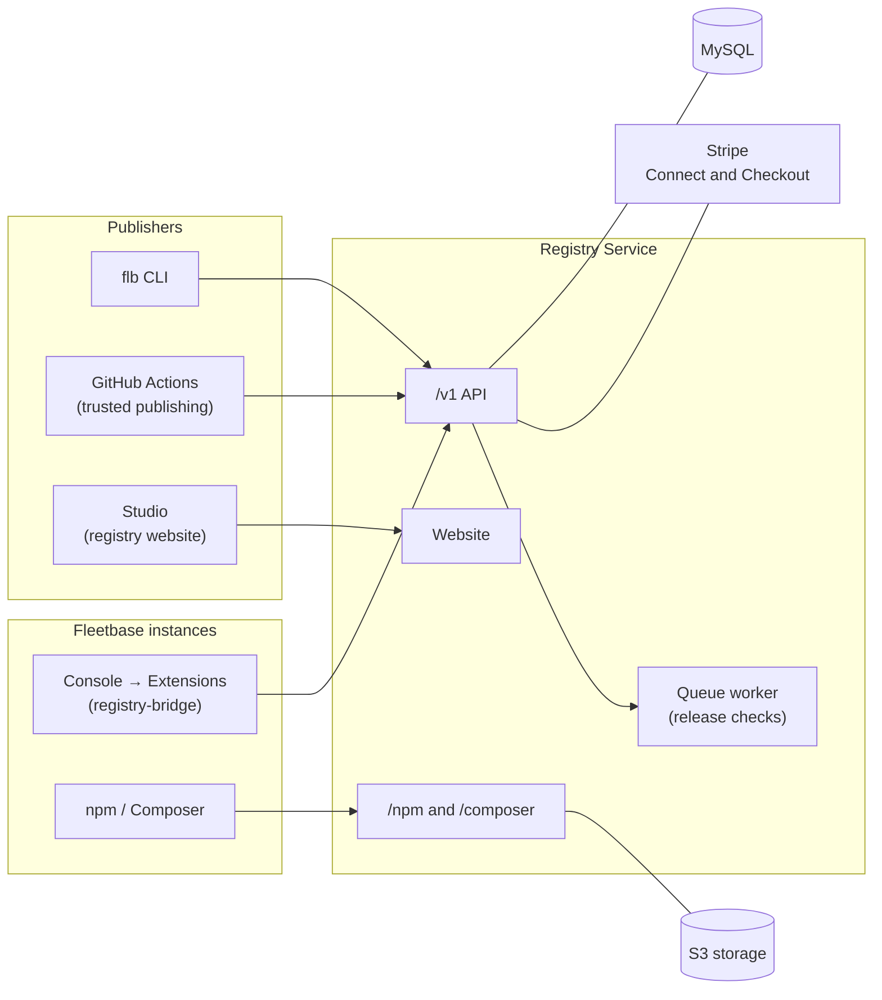

<div id="hero">
  <p align="center" dir="auto">
    <a href="https://fleetbase.io" rel="nofollow">
      
    </a>
  </p>
  <h1 align="center">Fleetbase Extensions Registry</h1>
  <p align="center" dir="auto">
    <a href="https://github.com/fleetbase/registry/actions/workflows/ci.yml"></a>
    <a href="https://github.com/fleetbase/registry/blob/main/LICENSE.md"></a>
    <a href="https://github.com/fleetbase/registry/tags"></a>
    
    
    
    <a href="https://discord.gg/V7RVWRQ2Wm"></a>
  </p>
  <p align="center" dir="auto">
    <strong>The service that publishes, reviews, sells and delivers Fleetbase extensions</strong>
    <br>
    <a href="https://registry.fleetbase.io" rel="nofollow">registry.fleetbase.io</a>
    ·
    <a href="docs/api.md">API reference</a>
    ·
    <a href="https://github.com/fleetbase/fleetbase-cli">CLI</a>
    ·
    <a href="https://www.fleetbase.io/docs" rel="nofollow">Fleetbase docs</a>
    ·
    <a href="https://discord.gg/V7RVWRQ2Wm" rel="nofollow">Discord</a>
  </p>
  <hr />
</div>

## What is the Registry?

The Registry is the system of record for [Fleetbase](https://github.com/fleetbase/fleetbase)
extensions. It holds publisher accounts and organizations, the public catalog, every release and
its review, the npm and Composer packages an instance installs, and the licences and purchases
behind paid extensions.

Everything else is a client of it:

- **Fleetbase instances**, cloud or self-hosted, browse the catalog and install extensions from
  the console's Extensions screen ([registry-bridge](https://github.com/fleetbase/registry-bridge)).
- **Publishers** build and publish with the [`flb` CLI](https://github.com/fleetbase/fleetbase-cli),
  from GitHub Actions, or in Studio on the registry website.
- **npm and Composer** read packages straight from it, like any other package registry.

Fleetbase runs the public registry at [registry.fleetbase.io](https://registry.fleetbase.io). The
code here is the same service, and you can run your own.



## Table of Contents

- [Features](#features)
- [How it works](#how-it-works)
- [Getting started](#getting-started)
- [Configuration](#configuration)
- [Using a registry](#using-a-registry)
- [HTTP surface](#http-surface)
- [Console commands](#console-commands)
- [Testing](#testing)
- [Repository layout](#repository-layout)
- [Deployment](#deployment)
- [Documentation](#documentation)
- [Related repositories](#related-repositories)
- [Contributing](#contributing)
- [Security](#security)
- [License](#license)

## Features

| | |
| --- | --- |
| **Catalog** | Listings with categories, tags, screenshots, pricing and publisher pages; search, filters and sorting; "works with my console" compatibility for every release |
| **npm and Composer registry** | An npm packument and tarball API and a Composer v2 repository, served from the same releases. Free packages are open; paid packages need a licence |
| **Release pipeline** | Upload once, then eight automated checks: manifest schema, compatibility ranges, package names, version order, size limits, archive safety, a secrets scan and the prebuilt dist |
| **Review** | A human reviews an extension's first release and any release that changes its package names, price or permissions. Everything else publishes as soon as its checks pass |
| **Prebuilt engines** | A release can carry a prebuilt engine, so a console installs it at runtime without rebuilding |
| **Instances** | An instance registers with a one-time code, reports installs, asks for updates, and can check every installed extension against a Fleetbase version before upgrading |
| **Commerce** | Paid extensions through Stripe Connect and Checkout: publisher payouts, a facilitator fee, tax, receipts, refunds and disputes |
| **Licences and seats** | A purchase gives an organization a licence with seats, one seat per instance. Free extensions get an automatic licence |
| **Private extensions** | Listings only the organizations you grant can see, download or install, optionally limited to named instances |
| **Trusted publishing** | Publish from GitHub Actions with a short-lived OIDC token instead of a stored secret |
| **Publisher website** | Discover, account and organization pages, Studio (listings, releases, access, insights, payouts) and the staff review console, in light and dark |
| **Analytics** | Installs, updates, uninstalls, active instances, purchases and revenue per listing or organization, with CSV export |

## How it works

**Publishing.** `flb publish` uploads the extension's `extension.json`, its engine tarball (npm),
its API archive (Composer) and, optionally, a prebuilt engine. A queue worker runs the checks and
records the result of each. Once they pass, the release is submitted: the review policy either
sends it to a staff reviewer or approves it on the spot. A published release appears in the
catalog and in npm and Composer metadata at once. See
[Listings, releases and review](docs/releases.md).

**Installing.** An organization owner mints a registration code and pastes it into their Fleetbase
instance, which exchanges it for an instance token. From then on the console reads the catalog,
downloads packages, and reports each install, update and uninstall. Installing claims a seat on
the organization's licence. See [Instance API](docs/instances.md).

**Tokens.** Every credential is a prefixed random token, stored only as a SHA-256 hash.

| Prefix | Kind | Held by |
| --- | --- | --- |
| `flbp_` | Personal token, scoped (`read`, `publish`, `install`, `instance:register`, `review`) and expiring | The CLI, CI jobs, npm and Composer clients |
| `flbi_` | Instance token | A registered Fleetbase instance |
| `flbt_` | Trusted publishing token, valid 15 minutes, limited to one listing's release routes | A GitHub Actions run |
| `flbs_` | Website session token | The server only; the browser holds a session cookie |

## Getting started

### Requirements

- PHP 8.3 or 8.4 with `mbstring`, `intl`, `bcmath`, `gd`, `zip` and `pdo_sqlite` or `pdo_mysql`
- Composer 2
- Node.js 22 (for the website's assets)
- Or only Docker, for the Compose stack

### Run it locally

This uses SQLite, the local disk and the mail log, so nothing else has to be installed.

```bash
git clone https://github.com/fleetbase/registry.git && cd registry
composer install
cp .env.example .env && php artisan key:generate
php artisan migrate --seed       # offers to create database/database.sqlite; seeds the categories
npm install && npm run build     # the website's assets
php artisan serve                # http://localhost:8000
```

Release checks run on the queue. Run a worker beside the server, or set `QUEUE_CONNECTION=sync`:

```bash
php artisan queue:work --timeout=900
```

For hot reload while working on the website, run `npm run dev` in place of `npm run build`.
`php artisan inertia:start-ssr` adds server-side rendering on `127.0.0.1:13714`; without it,
pages render in the browser.

### Run it with Docker

```bash
docker compose up --build
```

| Service | URL |
| --- | --- |
| Registry (API and website) | http://localhost:8000 |
| Mailpit (verification emails) | http://localhost:8025 |
| MinIO console | http://localhost:9001 (`minio` / `miniosecret`) |
| MySQL | `localhost:3307` (`registry` / `registry`) |

The stack runs the app, a queue worker, MySQL 8, MinIO as S3 storage and Mailpit. It mounts your
checkout, so build the website's assets on the host (`npm install && npm run build`).

### Sample data

```bash
php artisan registry:seed-website
```

adds a staff account (`staff@registry.test`) and a publisher (`publisher@registry.test`, owner of
the organization `acme`), both with the password `password123`, a submitted release waiting in
the review queue and a draft listing. It refuses to run in production.

```bash
php artisan registry:seed --seed-release
```

publishes a free and a paid extension from the fixture packages in `database/fixtures/packages`
and prints install tokens for an organization with a licence and one without, so you can point
real npm and Composer clients at the service.

## Configuration

Settings come from the environment. [`.env.example`](.env.example) lists them all with comments,
and [`config/registry.php`](config/registry.php) holds the registry's own. The ones you are most
likely to change, with their values in `.env.example`:

| Variable | In `.env.example` | What it does |
| --- | --- | --- |
| `APP_URL` | `http://localhost:8000` | The service's own address |
| `REGISTRY_PUBLIC_URL` | the request's host | Base URL written into npm and Composer metadata. Set it behind a proxy or CDN |
| `TRUSTED_PROXIES` | private and loopback ranges | Proxies whose `X-Forwarded-For` is believed: addresses or CIDR ranges, comma-separated, or `*`. Rate limits count per client address, so a proxy outside these ranges makes every client share one limit |
| `DB_CONNECTION` | `sqlite` | `mysql` in Docker and production |
| `REGISTRY_STORAGE_DISK` | `local` | Disk for tarballs, prebuilt engines, icons and screenshots. `s3` with the `AWS_*` variables for S3 or MinIO |
| `QUEUE_CONNECTION` | `database` | Release checks run here. A check may take up to 900 seconds, so keep the queue's `retry_after` above that (`DB_QUEUE_RETRY_AFTER=960`) |
| `MAIL_MAILER` | `log` | Verification codes, review results and receipts go out by mail |
| `SESSION_SECURE_COOKIE` | `false` | Set to `true` behind HTTPS |
| `GITHUB_CLIENT_ID`, `GITHUB_CLIENT_SECRET` | empty | Turns on "Continue with GitHub" on the website |
| `STRIPE_KEY`, `STRIPE_SECRET`, `STRIPE_WEBHOOK_SECRET` | empty | Turns on commerce. Commerce routes answer 503 until `STRIPE_SECRET` is set. See [Commerce](docs/commerce.md) |
| `REGISTRY_FACILITATOR_FEE_BPS` | `1000` | The fee kept on each sale, in basis points (1000 is 10%) |
| `REGISTRY_LICENCE_MAX_ACTIVATIONS` | `5` | Seats on a paid licence |
| `REGISTRY_SECRETS_SCANNER` | `auto` | `auto` runs the built-in rules and gitleaks when its binary is installed; `builtin`; or `off` |
| `REGISTRY_MAX_BUNDLE_BYTES`, `REGISTRY_MAX_DIST_BYTES` | 50 MB, 100 MB | Upload limits for an archive and for a prebuilt engine |
| `REGISTRY_CATALOG_CACHE_SECONDS` | `60` | How long catalog responses are cached |
| `REGISTRY_OIDC_AUDIENCE` | the registry's host | The audience GitHub Actions tokens must carry |
| `REGISTRY_MAINTENANCE` | `false` | Pauses publishing and checkout with a 503 |
| `REGISTRY_CLOUD_PLATFORM_SECRET` | empty | Lets Fleetbase Cloud register itself as one multi-tenant instance. Leave empty anywhere else |

The `@fleetbase` npm scope and the `fleetbase` Composer vendor are reserved for organizations
flagged as staff (`php artisan registry:staff <organization>`). The same flag gives an
organization's members the review console.

## Using a registry

**From a Fleetbase instance.** Open Extensions in the console. An instance talks to
`https://registry.fleetbase.io` unless its API is told otherwise:

```bash
# api/.env of the Fleetbase instance
REGISTRY_SERVICE_URL=https://registry.example.com
```

**From the CLI.**

```bash
npm install -g @fleetbase/cli
flb login
flb init --name "Fleet Insights" && cd fleet-insights
flb build
flb publish --submit
```

Point the CLI at another registry with `flb config set registry https://registry.example.com`,
`--registry <url>` or `FLB_REGISTRY`.

**From npm and Composer.**

```ini
# .npmrc
@acme:registry=https://registry.fleetbase.io/npm/
//registry.fleetbase.io/npm/:_authToken=flbp_…
```

```json
{
    "repositories": [{ "type": "composer", "url": "https://registry.fleetbase.io/composer" }]
}
```

Free packages need no token. For paid packages, npm sends the token from `.npmrc` and Composer
reads `COMPOSER_AUTH='{"bearer": {"registry.fleetbase.io": "flbp_…"}}'`. See
[Packages](docs/packages.md).

**From GitHub Actions.** Add the workflow as a trusted publisher in Studio, give the job
`permissions: id-token: write`, and run `flb publish`. No registry secret is stored in the
repository. See [Trusted publishing](docs/trusted-publishing.md).

## HTTP surface

| Path | For | Auth | Reference |
| --- | --- | --- | --- |
| `/v1/auth/*`, `/v1/account/*`, `/v1/organizations/*` | Accounts, tokens, organizations and members | None to sign in; then a personal token or the website session | [API](docs/api.md#auth-and-account) |
| `/v1/catalog/*` | Listings, releases, publishers, categories | None (a token reveals private listings) | [API](docs/api.md#public-catalog) |
| `/v1/publisher/*` | Listings, media, prices, releases, access grants, stats | `publish` scope | [API](docs/api.md#publisher-api) |
| `/v1/admin/*` | Review queue, suspensions, featuring, licences, fees, finance | `review` scope and a staff organization | [API](docs/api.md#admin-api) |
| `/v1/instances/*` | Registration, updates, compatibility, install reports, checkout | Instance token | [Instances](docs/instances.md) |
| `/v1/auth/oidc/github` | Exchange a GitHub Actions OIDC token for a publish token | The OIDC token | [Trusted publishing](docs/trusted-publishing.md) |
| `/v1/purchases/*`, `/v1/webhooks/stripe` | Website checkout and Stripe webhooks | Session or token; Stripe signature | [Commerce](docs/commerce.md) |
| `/npm/*` | npm packuments, tarballs and prebuilt engines | None, or a token for paid and private packages | [Packages](docs/packages.md) |
| `/composer/*` | Composer v2 repository and archives | None, or a token for paid and private packages | [Packages](docs/packages.md) |
| `/up` | Health check | None | |
| Everything else | The website | Session cookie | [Website](docs/website.md) |

Errors use the Fleetbase envelope `{"errors": ["…"]}`, and validation failures add a `fields`
map. Paged lists return `{"data": […], "meta": {…}}`. Routes are rate limited per account or IP.

## Console commands

| Command | What it does |
| --- | --- |
| `registry:staff <organization> [--revoke]` | Flags an organization as staff: reserved namespaces and the review console |
| `registry:maintenance on\|off\|status [--message=]` | Pauses or resumes publishing and checkout. The catalog, packages and installs keep working |
| `registry:seed [--seed-release] [--json]` | Seeds the categories; with `--seed-release`, a free and a paid published extension from the fixtures |
| `registry:seed-website [--json]` | Sample accounts, a listing and a release in review, for local work and the smoke test |
| `registry:stripe-sync [--dry-run]` | Reads the state of every connected Stripe account and mirrors paid prices that have no Stripe price yet |
| `registry:import --from=… [--dry-run] [--verify]` | Imports the catalog, purchases and installs of the previous cloud registry. See [Importing](docs/importing.md) |

## Testing

```bash
composer test         # Pest: feature and unit tests, on SQLite in memory
composer test:lint    # Pint, check only (composer lint fixes)
npm test              # Vitest: website components and page logic
npm run lint          # ESLint
npm run test:e2e      # Playwright smoke test of the website (run npm run build first)
```

The Playwright test starts its own server on port 8123 with a fresh database
(`scripts/e2e-server.sh`).

`tests/Conformance/packages.sh` drives real npm and Composer clients against a running service:

```bash
php artisan registry:seed --seed-release
php artisan serve &
tests/Conformance/packages.sh http://127.0.0.1:8000
```

CI runs all of these on every pull request, on PHP 8.3 and 8.4, and builds the Docker image.

## Repository layout

```
app/
  Access/, TrustedPublishing/   access grants for private listings; GitHub OIDC verification
  Actions/                      single-purpose actions (register an account, claim a licence seat)
  Analytics/                    publisher reports
  Auth/TokenGuard.php           the bearer-token guard behind every token kind
  Commerce/                     Stripe Connect, Checkout, webhooks, refunds, finance
  Console/Commands/             the registry:* commands
  Http/Controllers/             /v1 API, Packages/ (npm, Composer), Publisher/, Admin/, Web/ (pages)
  Import/                       importer for the previous cloud registry
  Instances/                    the pre-upgrade compatibility report
  Jobs/RunReleaseChecks.php     the queued release checks
  Models/                       one model per table
  Releases/                     pipeline, state machine, review policy, checks, archive inspection,
                                secrets rules
  Services/                     release storage, licence gate, listing access, npm and Composer metadata
  Support/                      semver and compatibility ranges, tarballs, catalog cache
config/registry.php             every registry setting and its default
database/                       migrations, the category seeder, fixture packages
docker/, Dockerfile             the image: nginx, php-fpm and the SSR renderer under s6
docs/                           reference pages (see Documentation)
e2e/                            Playwright smoke test
legacy/                         the previous Verdaccio-based registry
resources/js/                   the website: pages, components, layouts (Inertia and React)
resources/css/                  Tailwind entry and design tokens
resources/schemas/              the extension.json JSON Schema
routes/api.php, routes/web.php  API and package routes; website routes
scripts/                        e2e server, cutover rehearsal and dump helpers
tests/                          Pest feature and unit tests, the conformance script, fixtures
```

**Stack.** Laravel 12, MySQL 8 (SQLite for development and tests) and S3-compatible object
storage. The website is Inertia 3 with React 19, Tailwind 4 and Vite, served by the same Laravel
app, with optional server-side rendering.

## Deployment

The [`Dockerfile`](Dockerfile) builds one image that runs nginx, php-fpm and the website's
renderer, listening on port 8080.

| Target | Use |
| --- | --- |
| `app` | Any container host. Runs migrations when the container starts |
| `aws-app` | The same image wrapped with `ssm-parent`, which loads the environment from AWS SSM on ECS |

A deployment needs:

- MySQL 8 and an S3-compatible bucket (`REGISTRY_STORAGE_DISK=s3`).
- A second container from the same image running the queue worker:
  `php artisan queue:work --tries=3 --timeout=900`. It needs the same storage disk and cache
  store as the app, because a release that passes its checks can be published from the job.
- Outgoing mail.
- `REGISTRY_PUBLIC_URL` and `SESSION_SECURE_COOKIE=true` behind HTTPS.
- `TRUSTED_PROXIES`, if the load balancer or proxy reaches the service from a public address.
- The categories, seeded once: `php artisan registry:seed --force`.
- If a CDN sits in front of `/v1/catalog`, `/npm` and `/composer`, it must forward the
  `Authorization` header, or instances never see their private listings.
- `GET /up` as the health check.

Fleetbase's own registry deploys from this repository: a push to `deploy/<stack>` runs
[`cd.yml`](.github/workflows/cd.yml), which builds the `aws-app` target with
[`docker-bake.hcl`](docker-bake.hcl) and deploys the `app` and `queue` services to ECS. The
infrastructure itself is defined in a separate, private repository.

The previous Verdaccio-based registry is kept in [`legacy/`](legacy/LEGACY.md) and is still built
by the same workflow until it is retired. [docs/cutover.md](docs/cutover.md) is the runbook for
moving Fleetbase Cloud from it to this service.

## Documentation

| Page | Covers |
| --- | --- |
| [HTTP API reference](docs/api.md) | Conventions, accounts and tokens, the public catalog, the publisher API, the admin API, maintenance mode |
| [Packages: npm and Composer](docs/packages.md) | Package endpoints, client setup, the licence gate, storage, reserved namespaces |
| [Listings, releases and review](docs/releases.md) | Listings from `extension.json`, upload rules, the checks, release states, the review policy |
| [Instance API](docs/instances.md) | Registration and re-registration, updates, pre-upgrade compatibility, install rules, Fleetbase Cloud |
| [Private extensions](docs/private-extensions.md) | Visibility, access grants, caching, review |
| [Trusted publishing](docs/trusted-publishing.md) | Publishing from GitHub Actions with OIDC |
| [Commerce](docs/commerce.md) | Stripe setup, how money moves, prices, licences and seats, payouts, refunds, webhooks, instance checkout |
| [Publisher analytics](docs/analytics.md) | The stats APIs and what each figure counts |
| [Website](docs/website.md) | How the pages are built, sessions, server-side rendering, the route map |
| [Importing from Fleetbase Cloud](docs/importing.md) | `registry:import`: sources, options, mapping rules, the anomaly report |
| [Cutover runbook](docs/cutover.md) | Moving Fleetbase Cloud onto this service |

## Related repositories

| Repository | Role |
| --- | --- |
| [fleetbase/fleetbase](https://github.com/fleetbase/fleetbase) | The Fleetbase platform |
| [fleetbase/registry-bridge](https://github.com/fleetbase/registry-bridge) | The console's Extensions screen and the installer that runs on each instance |
| [fleetbase/fleetbase-cli](https://github.com/fleetbase/fleetbase-cli) | `flb`: scaffold, build, publish, and install from the terminal or CI |
| [fleetbase/starter-extension](https://github.com/fleetbase/starter-extension) | The template `flb init` scaffolds from |
| [fleetbase/ember-core](https://github.com/fleetbase/ember-core) | Console services, including the runtime loader for prebuilt engines |

## Contributing

Issues and pull requests are welcome. Read [CONTRIBUTING.md](CONTRIBUTING.md) first, and run
`composer test`, `composer test:lint`, `npm test` and `npm run lint` before you open a pull
request. If you change a route, update the page under [`docs/`](docs) that describes it.

Questions are best asked on [Discord](https://discord.gg/V7RVWRQ2Wm).

## Security

Do not open a public issue for a vulnerability. Email [hello@fleetbase.io](mailto:hello@fleetbase.io)
with enough detail to reproduce it, and give us time to fix it before you disclose it.

## License

[AGPL-3.0-or-later](LICENSE.md). Copyright © Fleetbase Pte Ltd.
